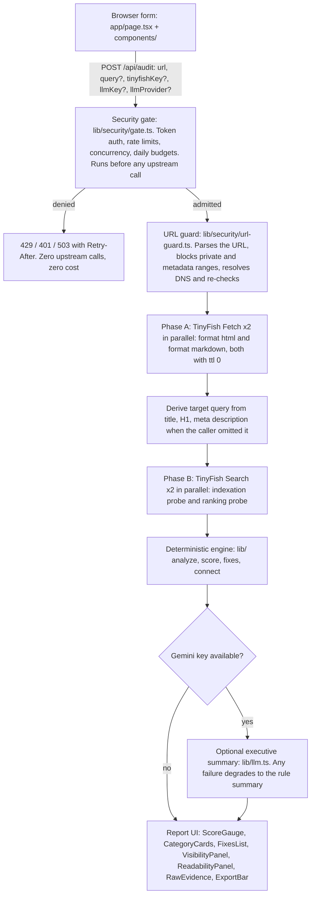

<div align="center">
  
  <h1>SiteScore</h1>
  <p><strong>AI search & readability auditor for any live URL.</strong></p>
</div>

## Introduction

SiteScore answers one question: can AI search tools and assistants actually read, understand, and surface your page? Paste any public URL and it runs live probes, scores the result 0 to 100, and gives you a prioritized fix list.

- Probes what an AI tool sees: fetches the page as HTML and as Markdown, exactly like an agent would.
- Probes whether the page surfaces in search: runs a `site:` index check and a ranking check for the target query.
- Every finding cites a measured value (word count, title length, rank position, latency). No generic "improve your SEO" tips.
- Fixes are labeled P0/P1/P2, with before/after code and copy-paste prompts you can hand to a coding agent.
- The audit itself is deterministic (a rule engine, not an LLM). An optional Gemini summary is extra, never required.
- Bring-your-own-key (BYOK): the deployed site bills your own TinyFish key, not the developer's.

Live app: https://site-score-ecru.vercel.app

## Tech Stack

[](https://nextjs.org)
[](https://react.dev)
[](https://www.typescriptlang.org)
[](https://tailwindcss.com)
[](https://nodejs.org)
[](https://docs.tinyfish.ai)
[](https://aistudio.google.com)
[](https://vercel.com)
[](https://upstash.com)

| Layer | What it is | Why it is here |
|---|---|---|
| Framework | Next.js 16 (App Router) + React 19 | One codebase for the page and the `/api/audit` server route |
| Language | TypeScript, strict mode | The audit contract and the engine stay verifiable |
| Styling | Tailwind CSS 4 | The report UI with no component library |
| Parsing | Cheerio | Extracts H1 and meta description from fetched HTML |
| Validation | Zod | Strict schema on every request body |
| Data | TinyFish Search + Fetch | The live probes (see section below) |
| Hosting | Vercel Hobby (free) | Stateless serverless, no database needed |

## Demo

Open https://site-score-ecru.vercel.app, paste a public URL (for example a blog post you own), and run the audit. It takes about 30 to 120 seconds because all probes hit live pages.

What you get back:

- A 0 to 100 score with a letter grade, split into Readability, Visibility, and Technical subscores.
- A check list where every pass, warn, or fail cites a measured value from the live fetch or search probe.
- Prioritized fixes with before/after code, plus a copy-paste prompt for each fix (`lib/agent-prompt.ts`) that a coding agent can execute without extra context.
- Visibility panel: is the page indexed (`site:` probe), what rank does it hold for the target query, which competitors rank above it.
- Readability panel: word count, title and meta lengths, link and image counts, fetch latency, the Markdown an AI extractor actually received.
- Export as Markdown, JSON, or print. Recent audits stay in your browser's localStorage only.

The deployed app is hard BYOK: it asks for your own TinyFish key under Settings, because the developer key fallback is off in production by default. See [Architectural Decisions](#architectural-decisions).

## Local Setup

Requirements:

- Node.js 20.9 or newer (enforced by Next.js 16).
- npm.
- A TinyFish API key, free at https://agent.tinyfish.ai/api-keys.
- Optionally a Gemini API key from https://aistudio.google.com, only for the AI summary.

```bash
git clone https://github.com/GxAditya/SiteScore.git
cd SiteScore
npm install
cp .env.example .env    # then put your TINYFISH_API_KEY in .env
npm run dev             # http://localhost:3000
```

Check your work before committing:

```bash
npm run typecheck       # tsc --noEmit, strict
npm run lint            # eslint
npm run build           # must pass before deploy
npm test                # engine self-test + 39 security assertions, no network needed
```

Smoke-test the API without opening the browser:

```bash
npm run start &
curl -s -X POST http://localhost:3000/api/audit \
  -H "Content-Type: application/json" \
  -d '{"url":"https://example.com","tinyfishKey":"YOUR_KEY"}'
```

With no key the route returns `400 missing_api_key` (it does that even on the live deployment; that is the BYOK guard working). With a valid key you get the full audit JSON.

Deploy to Vercel:

```bash
npm run build           # must pass locally first
vercel --prod
```

Then add `TINYFISH_API_KEY` (and optionally `GEMINI_API_KEY`) in Vercel Project Settings, Environment Variables, and redeploy. No other configuration is required. `vercel.json` only sets the Next.js framework default, and the audit route declares `maxDuration = 120` in code.

Environment variables (every knob is documented in `.env.example`):

| Variable | Required | Purpose |
|---|---|---|
| `TINYFISH_API_KEY` | yes, unless all callers BYOK | Server-side key for the probes |
| `GEMINI_API_KEY` | no | Optional AI summary |
| `UPSTASH_REDIS_REST_URL` / `_TOKEN` | recommended in production | Makes rate limits global across serverless instances; without them, limits are per instance |
| `ALLOW_PLATFORM_KEY` | leave unset | When false (production default) anonymous callers can never bill you |
| `SITESCORE_ACCESS_TOKEN` | no | When set, requests must send `x-sitescore-token` |

## Architecture



The request flow is exactly two phases and four metered calls per audit. Where things live:

| Path | Role |
|---|---|
| `app/page.tsx` + `components/` | Landing form, report panels, settings modal, export |
| `app/api/audit/route.ts` | The only endpoint: orchestration, TinyFish clients, response assembly |
| `lib/analyze.ts`, `score.ts`, `fixes.ts`, `connect.ts`, `engine.ts` | Deterministic engine: measures, scores, generates fixes, connects readability to visibility |
| `lib/security/` | Gate, rate limiter, URL/SSRF guard, crypto, redaction, audit log |
| `lib/llm.ts` | Optional Gemini call, server only |
| `lib/agent-prompt.ts`, `report-markdown.ts` | Fix prompts for coding agents and Markdown export |

Key properties:

- Live-only audits: every Fetch body sends `ttl: 0` and `/api/audit` responds `Cache-Control: no-store`, so nothing is ever served from or written to a cache. The report shows a Live badge with `fetchedAt`.
- Node runtime with `maxDuration = 120`; the client aborts at 150s.
- Failures are structured: a page that blocks bots or sits behind a login still returns a 200 report containing an explicit fail check and a P0 fix.

## Supported LLM Providers

The audit needs no LLM. Providers are only for the optional executive summary, and generation is server-side only.

| Provider | Model | Status | How it is called |
|---|---|---|---|
| Google Gemini | `gemini-2.0-flash` | Supported, optional | REST `generateContent`, key sent in the `x-goog-api-key` header, 25s server timeout |
| None | n/a | Default when no key is present | The rule engine's own summary is shown instead |

- The client picks `llmProvider` as `gemini` or `none` in the request body (validated by Zod).
- Without a usable key an audit still succeeds (`aiSummary.generated=false`). A bad key or a Gemini outage never fails an audit.
- Generation parameters are server-owned: a caller can never change the model, temperature, or token budget.
- Adding another provider is a contained change: extend `getAiSummary` in `lib/llm.ts` and the `llmProvider` enum in `app/api/audit/route.ts`.

## How TinyFish Is Used

TinyFish provides both live probes. The browser never talks to TinyFish directly; all calls happen inside `app/api/audit/route.ts` with the key in the `X-API-Key` header.

Endpoints used, 4 calls per audit:

| Endpoint | Calls | What it sends | What SiteScore gets from it |
|---|---|---|---|
| `POST https://api.fetch.tinyfish.ai` | 2, in parallel (Phase A): once with `format: "html"`, once with `format: "markdown"` | `{ urls: [url], format, links: true, image_links: true, ttl: 0, per_url_timeout_ms: 100000 }` | Title, description, language, author, published date, page text (HTML and Markdown), link and image counts, per-page latency, final URL after redirects |
| `GET https://api.search.tinyfish.ai?query=...` | 2, in parallel (Phase B) | Indexation probe: `query=site:<domain> "<slug words>"` with `include_domains=<domain>`. Ranking probe: `query=<target query>` | Whether the exact URL surfaces for the site query, its rank position for the target query, total results, and the competitor URLs ranking above it |

- `ttl: 0` on every Fetch call forces a fresh crawl; a saved copy is never used (PRD requirement 5).
- The target query is user-supplied or auto-derived from the fetched page's title, H1, or meta description.
- Error mapping: `401/403` from TinyFish becomes `invalid_api_key`, `429` becomes `rate_limited` with `Retry-After`, `5xx` becomes `tinyfish_unavailable`.
- Free-tier limits to expect: Search 30 req/min, Fetch 150 URLs/min.
- Upstream docs: https://docs.tinyfish.ai, keys: https://agent.tinyfish.ai/api-keys

## Architectural Decisions

**Why BYOK (bring your own key) by default.**

- Each audit makes 4 metered upstream calls and can run for up to 120 seconds. An unauthenticated public endpoint with a server key fallback is, verbatim from the security review, "an unauthenticated, unmetered credit card with the merchant's name on it".
- So the server key is used only when `ALLOW_PLATFORM_KEY` explicitly permits it, and that flag is `false` in production. The live deployment was verified: a keyless request returns `400 missing_api_key` and costs the developer nothing.
- Keys are never echoed in responses or logs. Logs store a truncated HMAC-SHA256 fingerprint instead. In the UI, keys live in page memory for the duration of a request and are never persisted.

**Minimal footprint: one framework, a short dependency list, no backend services.**

- The app deliberately avoids extra frameworks and libraries: no CSS component kit, no state manager, no ORM, no database, no auth provider, no persistent server. Seven runtime packages (`next`, `react`, `react-dom`, `cheerio`, `zod`, `motion`, `@phosphor-icons/react`) plus Tailwind's build-time PostCSS plugin; all tooling stays in devDependencies.
- The goal is fast, cheap startup on free hosting: a stateless serverless function on Vercel Hobby cold-starts with nothing to connect to and no migrations to run, and the whole app fits the free tier with zero paid add-ons.

**Deterministic engine first, LLM second.**

- The score comes from measured values in the fetched HTML/Markdown and the search results, so it is reproducible and testable offline (`npm test` proves good pages outscore thin ones with no network).
- The LLM only re-phrases findings into an executive summary, and any LLM failure degrades to the rule-based summary instead of failing the audit.

**Live-first, single endpoint.**

- `ttl: 0` plus `Cache-Control: no-store` everywhere means a report always reflects the page as it is right now.
- Everything (validation, gating, fetching, searching, scoring, LLM) happens in one route handler. Fewer moving parts, and no secret ever leaves the server.

## Security Techniques

The full threat model, findings by severity, and verification live in `docs/SECURITY.md`. In short, from `lib/security/`:

- Pre-flight gate (`gate.ts`): optional shared-token auth (constant-time compare), per-minute/hour/day rate limits on both the key fingerprint and the client IP, concurrency semaphores, and platform-wide daily budget ceilings. Every rejection happens before any upstream call, so blocked requests cost nothing.
- Fail-closed: if the configured Redis backend is unreachable, requests are denied with 503 rather than treated as unlimited.
- SSRF defense (`url-guard.ts`): strict URL parsing, CIDR blocks for private, link-local, CGNAT, multicast, and cloud-metadata ranges, then DNS resolution with a re-check of the actual address.
- Crypto (`crypto.ts`): AES-256-GCM with AAD binding, random 96-bit IVs, a `kid: key` keyring for zero-downtime rotation, and revocation by deleting a key id. Storage refuses to persist without a keyring.
- Redaction (`redact.ts`) and output hygiene: client errors pass a fixed allow-list of safe messages, upstream detail is redacted in logs, and no stack trace ever reaches a browser.
- Prompt-injection defense (`llm.ts`): page content and user queries are control-char-stripped, length-capped, and wrapped in BEGIN/END untrusted-data delimiters; the model runs single-shot with no tools, and the Gemini key travels in a header, never a query string.
- Hardened surfaces: response headers applied to every route in `next.config.js` (CSP with `frame-ancestors 'none'` and no wildcard `connect-src`, HSTS, `X-Frame-Options: DENY`, `nosniff`, `Referrer-Policy`, `Permissions-Policy`, COOP/CORP, `poweredByHeader: false`), and in the route itself a 16 KB request body cap with strict locked Zod schemas.
- Audit log (`audit-log.ts`): hash-chained JSON events recording key fingerprints, token counts, latency, and upstream call counts, with anomaly events on usage spikes.
- Concurrency-slot release is guaranteed in a `finally` block, because a leaked slot would slowly starve the service until all traffic is refused.

## Reference Docs

For a deep understanding, in reading order:

| Doc | What it covers |
|---|---|
| `docs/PRD.md` | The 8 product requirements the build must satisfy |
| `docs/PRODUCT.md` | Target users, positioning, capabilities and constraints, product principles |
| `docs/DESIGN.md` | The UI design system: palette, typography, layout, component rules |
| `docs/SECURITY.md` | Threat model, findings by severity, controls in place, operational notes |
| `.env.example` | Every environment variable with defaults and cost-protection knobs |
| `lib/selftest.ts` + `lib/security/selftest.ts` | Executable specification of engine and security behavior |
| `app/api/audit/route.ts` | The whole server-side story end to end |

Contributors: run `npm test` before opening a PR; both self-tests exit non-zero on failure and are safe for CI.

## Licence

MIT. See LICENSE.
